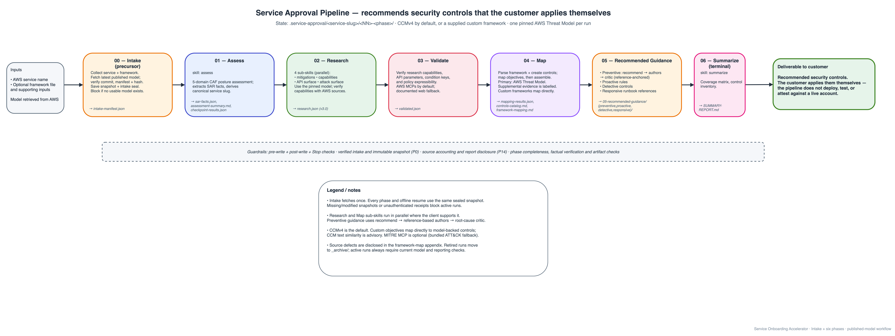

# Service Approval

Generate AWS security controls for any AWS service. Point it at a service (and,
optionally, your threat model and control framework); it researches the service
against authoritative AWS sources, maps every capability to a control framework,
and produces a full set of **recommended** preventive, proactive, detective, and
responsive controls. It recommends the controls — **you deploy them yourself**;
the tool never touches a live account.

It runs as [Agent Skills](https://agentskills.io), so the same skills work in
Claude Code, Kiro, and GitHub Copilot.

---

## Prerequisites

| You need | When | Why |
|----------|------|-----|
| One of: Claude Code, Kiro IDE, or VS Code + GitHub Copilot | always | the client that runs the skills |
| [`uv`](https://docs.astral.sh/uv/getting-started/installation/) on your PATH | default mode | the `aws-documentation` MCP server runs via `uvx awslabs.*@latest`; not needed in no-MCP mode |
| Python 3.9+ | always | the validators and hooks that gate the pipeline |
| An AWS CLI profile | optional | only for Tier 2 policy validation (Access Analyzer); the pipeline never deploys |

No AWS credentials are required to generate controls — every fact comes from
public AWS documentation and knowledge MCP servers.

**Running without MCP:** MCP servers are the default, but the whole pipeline can
also run with no MCP servers at all — pass the `--no-mcp` flag and every fact is
verified over the web against an allowlist of AWS documentation domains instead.
See [`rules/web-access.md`](rules/web-access.md) for the mechanism and the
"Running without MCP" section of [`docs/USAGE-COPILOT.md`](docs/USAGE-COPILOT.md)
for details.

---

## Install

Clone once, then pick the path that matches your client.

**Claude Code (fastest — uses `manifest.yaml` directly, skips multi-client detection):**

```bash
git clone git@github.com:awslabs/service-onboarding-accelerator-on-aws.git
cd service-onboarding-accelerator-on-aws
./install-claude.sh
```

**All clients (Claude Code + Kiro + Copilot — auto-detects what's installed):**

```bash
git clone git@github.com:awslabs/service-onboarding-accelerator-on-aws.git
cd service-onboarding-accelerator-on-aws
./install.sh          # macOS / Linux
# or Windows PowerShell:
.\install.ps1
```

Update any time with `git pull` (re-run the install script for Claude Code so the
marketplace symlink refreshes). To auto-sync on every pull:

```bash
make enable-auto-sync
```

Per-client details, marketplace registration, and uninstall live in the usage
guides:

| Client | Guide |
|--------|-------|
| Claude Code | [`docs/USAGE-CLAUDE-CODE.md`](docs/USAGE-CLAUDE-CODE.md) |
| Kiro IDE | [`docs/USAGE-KIRO.md`](docs/USAGE-KIRO.md) |
| GitHub Copilot | [`docs/USAGE-COPILOT.md`](docs/USAGE-COPILOT.md) |
| All clients + troubleshooting | [`docs/INSTALL.md`](docs/INSTALL.md) |

> Windows needs Developer Mode ON for the symlink install (one-time toggle).

---

## How to run

Invoke the pipeline and answer the short intake prompts. The intake step asks for
the service name and control framework; if you pass them as flags, it skips the
corresponding prompt.

**Claude Code** — slash command:

```
/service-approval ./input --service=s3
```

**Kiro** — keyword or explicit invocation:

```
run service approval for s3
```

**GitHub Copilot** — `@`-mention in Agent mode:

```
@service-approval ./input --service=s3
```

### Framework selection

The default framework is **CCMv4** (with always-on MITRE ATT&CK threat mapping).
NIST 800-53, CIS Benchmarks, and ISO 27001 are available with `--framework=<type>`;
a custom framework file is anchored to CCMv4 guidance automatically. If a framework
file is present in your input folder it is auto-detected; otherwise the intake step
asks (or you pass `--framework=`).

### A concrete example

```
/service-approval ./input --service=bedrock-agentcore --framework=ccmv4
```

This reads any customer docs in `./input/` (threat model, mitigation report,
framework spreadsheet), researches `bedrock-agentcore`, and writes all output under
`.service-approval/bedrock-agentcore/`.

---

## What you get

Output lands in `.service-approval/<service-slug>/` in your working directory, one
directory per phase:

```
.service-approval/<service-slug>/
  00-intake/               ← intake manifest
  01-assess/               ← SAR facts, checkpoints, assessment summary
  02-research/             ← research.json (merged from 4 sub-skills)
  03-validate/             ← validated.json
  04-map/                  ← mapping-results.json, controls-catalog.md, framework-mapping.md
  05-recommended-guidance/ ← all generated control artifacts (preventive, proactive, detective, responsive)
  06-summarize/            ← SUMMARY-REPORT.md, ARTIFACT-FLOW-MATRIX.md
  mcp-calls.log            ← MCP call audit log
```

The key deliverable is **`06-summarize/SUMMARY-REPORT.md`** — the framework
coverage matrix, mitigation traceability, control inventory, and a preventive
coverage accounting.

The `05-recommended-guidance/` tree holds the artifacts. Exact counts vary by
service surface area; the ranges below reflect observed output across validated
services:

| Category | Files | Key artifacts |
|----------|-------|---------------|
| Preventive | 9–12 | SCPs (split), resource policies, KMS key policy, permission boundary, VPC endpoint, RCP, tag policies |
| Proactive | 12–15 | CFN Guard rules, OPA policies (per resource type), Checkov config + custom policies, CFN hooks |
| Detective | 34–47 | Config rules + Lambda handlers, EventBridge rules, CloudWatch alarms, Access Analyzer, compensating controls |
| Responsive | 6 | Lambda remediator + SAM template, SSM runbooks (org + account), Step Functions workflow |

---

## The pipeline

The tool runs an Intake precursor plus six numbered phases. Each phase consumes the
previous phase's output — a strict DAG — and writes to its own directory.



- **Intake** — collects the service name and framework choice → `intake-manifest.json`.
- **Assess** — 5-domain CAF security posture assessment.
- **Research** — discovers capabilities, API surface, and MITRE ATT&CK attack
  surface (4 parallel sub-skills, then merged) → `research.json`.
- **Validate** — cross-references every research claim via MCP → `validated.json`.
- **Map** — parses the framework, generates controls, maps them to objectives, and
  assembles → `mapping-results.json` + reports.
- **Recommended Guidance** — produces the control artifacts across all
  categories (preventive is a gated sub-pipeline).
- **Summarize** — the coverage matrix and control inventory → `SUMMARY-REPORT.md`.

---

## Flags

If you provide no framework flag or file, the tool defaults to CCMv4 with MITRE
ATT&CK threat mapping.

| Flag | Description | Default |
|------|-------------|---------|
| `./input-folder` | Folder with input files (`.md`, `.json`, `.xlsx`, `.pdf`, `.docx`) | None |
| `--service=<name>` | AWS service ID (e.g., `bedrock-agentcore`, `s3`, `kms`) | Required if no folder |
| `--framework=<type>` | Control framework (`ccmv4`, `nist`, `cis`, `iso`) | `ccmv4` (asked at intake; flag bypasses the prompt) |
| `--framework-file=<path>` | Explicit path to a framework file | Auto-detect from input |
| `--from-intake=<file>` | Read an intake YAML instead of prompting | None |
| `--interactive` | Force the interactive intake form | false |
| `--include-unverified` | Include unverified findings in generation | false |
| `--dry-run` | Lint artifacts only, no deployment | false |
| `--clean` | Delete existing `.service-approval/` state before the run | false |
| `--no-mcp` | Run without MCP servers — verify facts over the web (see "Running without MCP" above) | false (MCP is the default) |

---

## Troubleshooting

| Symptom | Fix |
|---------|-----|
| `/service-approval` command not found (Claude Code) | Re-run `./install-claude.sh` from the repo, then `/reload-plugins`. |
| Kiro doesn't activate the Power | It's keyword-triggered — include "service approval" or the service name, or say "use the service-approval power". |
| MCP server not connecting (`fetch failed`, `spawn uvx ENOENT`) | Confirm `uv` is on PATH (`which uv`); approve the MCP connection when prompted. On macOS, GUI-launched apps may not see `~/.local/bin` — see [`docs/TESTING-KIRO.md`](docs/TESTING-KIRO.md). |
| Plugin works in the repo but not elsewhere (Claude Code) | The marketplace registration didn't take — `claude plugin marketplace add .` then `claude plugin install service-approval@service-approval --scope user`. |
| A phase reports too few MCP calls / integrity failure | The Stop hook enforces pipeline integrity (P1–P7); read `06-summarize/SUMMARY-REPORT.md` and `pipeline.log` for which check failed, then re-run from the failing phase. |

---

## Validation

Two complementary layers keep the output trustworthy.

The **review gates and correctness checks** that run *during* the pipeline — two
review gates, the root-cause critic, reference-anchor enforcement, the
Canopy-factual check, and conflict detection — are described in
[`docs/DESIGN.md`](docs/DESIGN.md).

The **artifact correctness checks** below confirm the generated control
artifacts are syntactically valid and policy-sound, and run automatically at
session end:

**Tier 1 — Static (no credentials)**
- JSON/YAML parse, Python handler compilation
- cfn-lint, CFN Guard syntax, OPA check

**Tier 2 — AWS API (credentials required)**
- IAM Access Analyzer `validate-policy` for SCPs, identity policies, resource policies

---

## How it works / accuracy model

The pipeline is built around a deterministic, citation-gated mapping layer and
reference-anchored preventive controls: every confident mapping cites its evidence,
and every preventive policy is adapted from a published AWS sample rather than
invented. The full accuracy model — the applicability screen, Canopy traceability
and citation verification, per-domain coverage ceilings, the source-priority order,
and the validation layers — is documented in **[`docs/DESIGN.md`](docs/DESIGN.md)**.

The skills that make up the pipeline live under [`skills/`](skills/); each is a
standalone Agent Skills folder with its own `SKILL.md`, so the same skills work
across every supported client.

---

## Security

For information about contributing and reporting security issues, see
[`CONTRIBUTING`](CONTRIBUTING.md).

## License

This project is licensed under the Apache-2.0 License.
